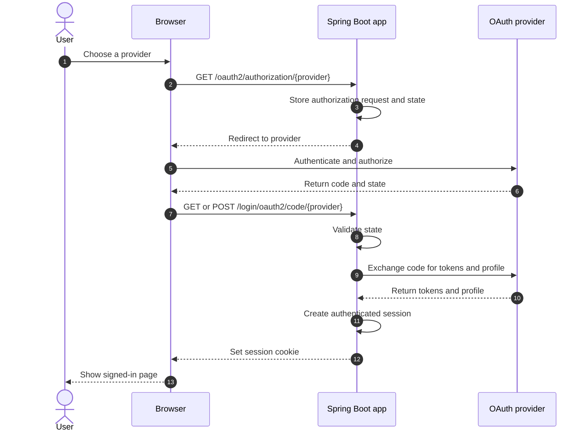

# Spring Security Social Login Demo

[](https://openjdk.org/projects/jdk/25/)
[](https://spring.io/projects/spring-boot)
[](https://spring.io/projects/spring-security)
[](https://maven.apache.org/)
[](LICENSE)

[简体中文](README.zh-CN.md) | English

A server-rendered social login sample built with Spring Security OAuth2 Client. It supports GitHub, Google, Facebook, and Apple. Configure any subset of the providers. The home page displays only providers with both credentials set.

## Create provider credentials

Register an OAuth client with each provider you want to use. The callback URI must match the value below exactly, including the scheme, port, and path.

| Provider | Callback URI | Environment variables | Scopes requested by this sample |
| --- | --- | --- | --- |
| GitHub | `http://localhost:8080/login/oauth2/code/github` | `GITHUB_CLIENT_ID`, `GITHUB_CLIENT_SECRET` | `read:user` |
| Google | `http://localhost:8080/login/oauth2/code/google` | `GOOGLE_CLIENT_ID`, `GOOGLE_CLIENT_SECRET` | `openid`, `profile`, `email` |
| Facebook | `http://localhost:8080/login/oauth2/code/facebook` | `FACEBOOK_CLIENT_ID`, `FACEBOOK_CLIENT_SECRET` | `public_profile`, `email` |
| Apple | `https://your-domain.example/login/oauth2/code/apple` | `APPLE_CLIENT_ID`, `APPLE_CLIENT_SECRET` | `openid`, `name`, `email` |

### GitHub

1. Open GitHub **Settings → Developer settings → OAuth Apps**.
2. Select **New OAuth App**. Enter an application name and `http://localhost:8080` as the homepage URL.
3. Set the authorization callback URL to `http://localhost:8080/login/oauth2/code/github`, then register the app.
4. Copy the **Client ID** from the app page.
5. Select **Generate a new client secret** and copy the secret. GitHub's [OAuth app creation guide](https://docs.github.com/en/apps/oauth-apps/building-oauth-apps/creating-an-oauth-app) describes these fields.

### Google

1. Create or select a project in [Google Cloud Console](https://console.cloud.google.com/).
2. Open **Google Auth Platform** and configure the app name, audience, and contact information. If the audience is **External** and the app is in testing mode, add the Google accounts that will test the login.
3. Open **Clients**, select **Create client**, and choose **Web application**.
4. Add `http://localhost:8080/login/oauth2/code/google` under **Authorized redirect URIs**. This server-rendered app does not need a JavaScript origin.
5. Create the client and copy its **Client ID** and **Client secret**. Google's [Web server OAuth guide](https://developers.google.com/identity/protocols/oauth2/web-server) explains the client setup and exact redirect URI matching.

### Facebook

1. Sign in to [Meta for Developers](https://developers.facebook.com/) and create an app for Facebook Login.
2. Add the **Facebook Login** use case or product and configure its **Web** settings.
3. Enable **Client OAuth Login** and **Web OAuth Login**. Add `http://localhost:8080/login/oauth2/code/facebook` to **Valid OAuth Redirect URIs**.
4. Open **App settings → Basic**. Copy the **App ID** as `FACEBOOK_CLIENT_ID`. Reveal and copy the **App Secret** as `FACEBOOK_CLIENT_SECRET`.
5. In development mode, limit sign-in to app roles and test accounts. Follow Meta's dashboard instructions for review and publishing before allowing other users. See [Facebook Login for the web](https://developers.facebook.com/docs/facebook-login/web/) for provider setup.

The sample pins Facebook Login and Graph API endpoints to `v26.0`, overriding Spring Security's older fixed Facebook preset. Update the single `FACEBOOK_API_VERSION` constant when adopting another Meta API version.

### Apple

Apple requires an HTTPS website and a Services ID. A `localhost` callback does not work for this provider.

1. In the Apple Developer portal, enable **Sign in with Apple** for a primary App ID.
2. Create a **Services ID**, enable **Sign in with Apple**, and associate it with that primary App ID.
3. Configure the website domain and register `https://your-domain.example/login/oauth2/code/apple` as a return URL. The domain must be reachable over HTTPS. Follow Apple's [web configuration guide](https://developer.apple.com/help/account/capabilities/configure-sign-in-with-apple-for-the-web).
4. Use the **Services ID identifier** as `APPLE_CLIENT_ID`.
5. Create a Sign in with Apple key for the primary App ID and download its `.p8` file. Keep this private key out of the repository.
6. Create a client-secret JWT with the following header and claims:

   - Header: `alg=ES256`, `kid=<KEY_ID>`.
   - `iss`: your Team ID.
   - `iat`: the current Unix timestamp.
   - `exp`: a Unix timestamp no more than six months after `iat`.
   - `aud`: `https://appleid.apple.com`.
   - `sub`: your Services ID.

   Sign the JWT with the `.p8` key using ES256. Use the finished JWT as `APPLE_CLIENT_SECRET`. Apple lists the [client-secret claims and signing rules](https://developer.apple.com/documentation/accountorganizationaldatasharing/creating-a-client-secret).

The sample requests Apple's `name` and `email` scopes, so Apple sends the authorization response as `form_post`. The sample sets this mode only for Apple and ignores CSRF only for POST requests to `/login/oauth2/code/apple`. Spring Security still validates OAuth `state`. Because the callback is a cross-site POST, configure the session cookie as `SameSite=None; Secure` and serve the app over HTTPS:

```dotenv
SESSION_COOKIE_SAME_SITE=none
SESSION_COOKIE_SECURE=true
```

## Run locally

Copy `.env.sample` to `.env`. Set the client ID and secret for at least one provider, then start the app:

```bash
cp .env.sample .env
./mvnw spring-boot:run
```

The app reads `.env` at startup. You can also export the values in your shell. A provider appears only when both of its values are non-empty. If you set only one value, the app reports a configuration error. With no providers configured, the app starts and shows setup guidance.

Keep `.env`, client secrets, Apple client-secret JWTs, and Apple's `.p8` private key out of Git. The repository ignores `.env`.

Open [http://localhost:8080](http://localhost:8080) to use the configured providers. The local HTTP setup works with GitHub, Google, and Facebook. Use a registered HTTPS development domain for Apple.

## Login flow



`POST /logout` requires CSRF and clears this application's session. It does not sign the user out of the provider.

Spring Security handles the OAuth authorization request, callback, state validation, code exchange, and session. The sample does not expose OAuth tokens, client secrets, or raw provider errors to the page.

## Verify

Run the behavior tests with:

```bash
./mvnw test
```

The tests cover configured provider buttons, GitHub and Apple authorization requests, generic login errors, profile rendering, and CSRF-protected logout. They do not complete a live provider round trip. Live login requires real provider credentials and the matching registered callback URI.

## Scope

This sample has no database, local account lifecycle, account linking, application JWT, resource server, role mapping, or provider logout. Signing out clears the local session, not the session at the provider. Review those requirements before adapting the sample for production.

## License

Apache License 2.0. See [LICENSE](LICENSE).
