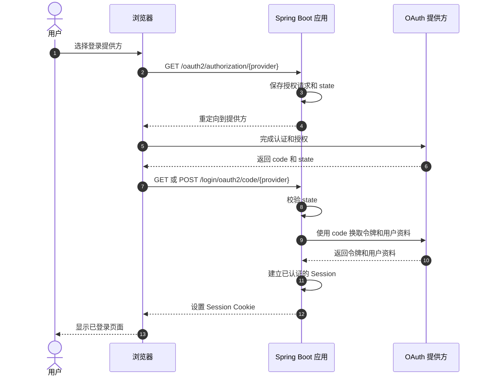

# Spring Security 社交登录示例

[](https://openjdk.org/projects/jdk/25/)
[](https://spring.io/projects/spring-boot)
[](https://spring.io/projects/spring-security)
[](https://maven.apache.org/)
[](LICENSE)

简体中文 | [English](README.md)

这是一个使用 Spring Security OAuth2 Client 的服务端渲染社交登录示例，支持 GitHub、Google、Facebook 和 Apple。你可以按需配置其中任意提供方。首页只显示同时配置了 Client ID 和 Secret 的提供方。

## 创建各提供方的客户端凭证

先在要使用的提供方注册 OAuth 客户端。回调地址必须与下表完全一致，包括协议、端口和路径。

| 提供方 | 回调地址 | 环境变量 | 示例请求的授权范围 |
| --- | --- | --- | --- |
| GitHub | `http://localhost:8080/login/oauth2/code/github` | `GITHUB_CLIENT_ID`、`GITHUB_CLIENT_SECRET` | `read:user` |
| Google | `http://localhost:8080/login/oauth2/code/google` | `GOOGLE_CLIENT_ID`、`GOOGLE_CLIENT_SECRET` | `openid`、`profile`、`email` |
| Facebook | `http://localhost:8080/login/oauth2/code/facebook` | `FACEBOOK_CLIENT_ID`、`FACEBOOK_CLIENT_SECRET` | `public_profile`、`email` |
| Apple | `https://你的域名/login/oauth2/code/apple` | `APPLE_CLIENT_ID`、`APPLE_CLIENT_SECRET` | `openid`、`name`、`email` |

### GitHub

1. 打开 GitHub **Settings → Developer settings → OAuth Apps**。
2. 选择 **New OAuth App**，填写应用名称，并将 `http://localhost:8080` 填为主页地址。
3. 将授权回调地址设为 `http://localhost:8080/login/oauth2/code/github`，然后注册应用。
4. 在应用页面复制 **Client ID**。
5. 选择 **Generate a new client secret** 并复制生成的 Secret。字段说明见 GitHub 的[创建 OAuth App 指南](https://docs.github.com/en/apps/oauth-apps/building-oauth-apps/creating-an-oauth-app)。

### Google

1. 在 [Google Cloud Console](https://console.cloud.google.com/) 中创建或选择一个项目。
2. 打开 **Google Auth Platform**，设置应用名称、受众和联系信息。如果受众选择 **External**，并且应用仍处于测试模式，请添加用于测试登录的 Google 账号。
3. 打开 **Clients**，选择 **Create client**，然后选择 **Web application**。
4. 在 **Authorized redirect URIs** 中添加 `http://localhost:8080/login/oauth2/code/google`。这是服务端渲染应用，无需配置 JavaScript 来源。
5. 创建客户端，复制 **Client ID** 和 **Client secret**。Google 的[Web 服务器 OAuth 指南](https://developers.google.com/identity/protocols/oauth2/web-server)说明了客户端配置和回调地址的精确匹配要求。

### Facebook

1. 登录 [Meta for Developers](https://developers.facebook.com/)，创建一个用于 Facebook Login 的应用。
2. 添加 **Facebook Login** 用例或产品，并配置其 **Web** 设置。
3. 启用 **Client OAuth Login** 和 **Web OAuth Login**。在 **Valid OAuth Redirect URIs** 中添加 `http://localhost:8080/login/oauth2/code/facebook`。
4. 打开 **App settings → Basic**。复制 **App ID** 作为 `FACEBOOK_CLIENT_ID`。显示并复制 **App Secret** 作为 `FACEBOOK_CLIENT_SECRET`。
5. 应用处于开发模式时，只允许应用角色成员和测试账号登录。要允许其他用户登录，请按 Meta 控制台要求完成审核和发布。详细步骤见 [Facebook Login 网页接入文档](https://developers.facebook.com/docs/facebook-login/web/)。

示例将 Facebook Login 和 Graph API 端点固定为 `v26.0`，覆盖 Spring Security 内置的旧版 Facebook 端点。升级到其他 Meta API 版本时，修改代码中的 `FACEBOOK_API_VERSION` 常量即可。

### Apple

Apple 要求网站使用 HTTPS 和 Services ID。`localhost` 回调不适用于 Apple 登录。

1. 在 Apple Developer 门户中，为一个主 App ID 启用 **Sign in with Apple**。
2. 创建 **Services ID**，启用 **Sign in with Apple**，并将 Services ID 关联到该主 App ID。
3. 配置网站域名，并将 `https://你的域名/login/oauth2/code/apple` 注册为 return URL。网站域名必须能够通过 HTTPS 访问。请参考 Apple 的[网页配置指南](https://developer.apple.com/help/account/capabilities/configure-sign-in-with-apple-for-the-web)。
4. 将 **Services ID 标识符**设为 `APPLE_CLIENT_ID`。
5. 为主 App ID 创建 Sign in with Apple 私钥并下载 `.p8` 文件。不要把私钥放进仓库。
6. 使用以下 Header 和声明生成 client-secret JWT：

   - Header：`alg=ES256`，`kid=<KEY_ID>`。
   - `iss`：你的 Team ID。
   - `iat`：当前 Unix 时间戳。
   - `exp`：Unix 时间戳，且不能晚于 `iat` 六个月以上。
   - `aud`：`https://appleid.apple.com`。
   - `sub`：你的 Services ID。

   使用 `.p8` 私钥和 ES256 对 JWT 签名。将生成的 JWT 设为 `APPLE_CLIENT_SECRET`。Apple 的[client secret 创建文档](https://developer.apple.com/documentation/accountorganizationaldatasharing/creating-a-client-secret)说明了声明和签名要求。

示例请求 Apple 的 `name` 和 `email` 授权范围，因此 Apple 会使用 `form_post` 发送授权响应。示例只为 Apple 启用该模式，并且只对发往 `/login/oauth2/code/apple` 的 POST 请求排除 CSRF 检查。Spring Security 仍会验证 OAuth `state`。由于回调是跨站 POST，请将 Session Cookie 设为 `SameSite=None; Secure`，并通过 HTTPS 运行应用：

```dotenv
SESSION_COOKIE_SAME_SITE=none
SESSION_COOKIE_SECURE=true
```

## 本地运行

复制 `.env.sample` 为 `.env`。至少填写一个提供方的 Client ID 和 Secret，然后启动应用：

```bash
cp .env.sample .env
./mvnw spring-boot:run
```

应用启动时读取 `.env`。你也可以在 Shell 中导出环境变量。只有 Client ID 和 Secret 都非空时，首页才会显示对应的提供方。如果只填写其中一个，应用会报配置错误。如果没有配置任何提供方，应用仍会启动并显示设置说明。

请勿将 `.env`、客户端 Secret、Apple client-secret JWT 或 Apple `.p8` 私钥提交到 Git。仓库已忽略 `.env` 文件。

打开 [http://localhost:8080](http://localhost:8080) 使用已配置的提供方。本地 HTTP 地址适用于 GitHub、Google 和 Facebook。Apple 登录需要使用已注册的 HTTPS 开发域名。

## 登录流程



`POST /logout` 需要 CSRF 令牌，并清除本站 Session；它不会退出用户在提供方的会话。

Spring Security 负责 OAuth 授权请求、回调、state 校验、授权码交换和 Session。示例不会向页面输出 OAuth Token、客户端 Secret 或提供方原始错误。

## 验证

运行行为测试：

```bash
./mvnw test
```

测试覆盖已配置的提供方按钮、GitHub 和 Apple 授权请求、通用登录错误、资料渲染以及带 CSRF 保护的退出登录。测试不会完成真实提供方的 OAuth 往返流程。真实登录需要有效凭证和已注册的匹配回调地址。

## 范围

示例不包含数据库、本地账号生命周期、账号关联、应用 JWT、资源服务器、角色映射或提供方退出登录。退出登录只清除本站 Session，不会退出用户在提供方的会话。用于生产前，请先评估这些需求。

## 许可证

Apache License 2.0。详见 [LICENSE](LICENSE)。
